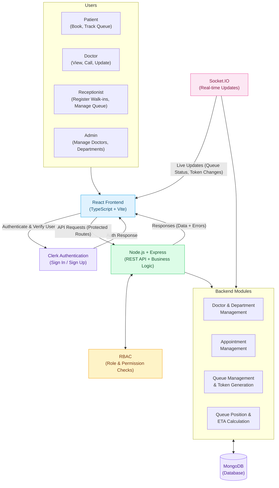

# KramSetu — Smart Hospital Queue Management System

## 1. Project Title and Description

**KramSetu** is a web-based Smart Hospital Queue Management System designed to simplify patient appointments and manage hospital queues efficiently.

The system allows patients to book appointments and track their queue status, while doctors and receptionists can manage consultations and patient flow. Administrators can manage doctors and departments.

Our goal is to reduce unnecessary waiting, improve queue transparency, and make hospital visits more organized.

## 2. Problem Statement

Hospitals often experience long queues, overcrowded waiting areas, and uncertainty about consultation times. Patients may have to wait for extended periods without knowing their current queue position or when they will be called.

Manual queue management can also make it difficult for hospital staff to coordinate appointments and walk-in patients efficiently.

KramSetu aims to address these problems through a centralized digital system that manages appointments, generates queue tokens, and provides real-time queue status updates.

## 3. Target Users

- **Patients:** Book appointments, receive queue tokens, and track their queue position and estimated waiting time.
- **Doctors:** View waiting patients, call the next patient, and update consultation status.
- **Receptionists:** Register walk-in patients, manage queue entries, and assist patients with appointments.
- **Administrators:** Manage doctor profiles, departments, and basic system information.

## 4. Existing Solutions

### 4.1 Qminder
Website: https://www.qminder.com/

Qminder provides digital queue management solutions that help organizations organize visitors, manage waiting lines, and improve service flow.

**Difference:** KramSetu focuses specifically on a hospital workflow involving patient appointments, walk-in registration, doctor-specific queues, and consultation status tracking.

### 4.2 Waitwhile
Website: https://waitwhile.com/

Waitwhile provides virtual waitlists, appointment scheduling, and queue management tools for businesses and service providers.

**Difference:** KramSetu is designed around hospital roles and consultation workflows, including doctors, receptionists, patients, and departments.

### 4.3 Practo
Website: https://www.practo.com/

Practo offers healthcare services that include doctor discovery and appointment booking.

**Difference:** KramSetu's primary focus is managing the patient's queue after booking or walk-in registration, including token progression and estimated waiting time.

*Note: These products have broader feature sets than our proposed MVP. The comparison describes their general capabilities, not a claim that they lack similar features.*

## 5. Proposed Solution and Innovation

KramSetu proposes a centralized web application that connects patients, doctors, receptionists, and administrators through a common queue management system.

The proposed improvements include:

- Digital appointment booking and queue token generation.
- Registration of walk-in patients by receptionists.
- Doctor-specific queues to organize consultations.
- Live queue position and estimated waiting time.
- Queue status updates when a patient is called, completed, or skipped.
- Role-based access so each user can access the relevant functions.

The key focus is **queue transparency and coordinated patient flow**, rather than appointment booking alone.

## 6. Minimum Viable Product (MVP) Features

### Patient
- Register and log in securely.
- View available departments and doctors.
- Book an appointment.
- View the assigned token number.
- Track queue position and estimated waiting time.
- View appointment and queue status.

### Doctor
- View the current consultation queue.
- Call the next patient.
- Mark a consultation as completed.
- Skip a patient when necessary.

### Receptionist
- Register walk-in patients.
- Add eligible patients to a doctor's queue.
- View and manage the queue.

### Administrator
- Add and manage departments.
- Add and manage doctor profiles.

### System
- Store appointment and queue information in a database.
- Apply role-based access control.
- Update queue information after queue operations.
- Display appropriate messages when no patients are waiting.

**MVP scope:** One hospital, a small number of departments, and a few doctors. Advanced features such as payments, SMS notifications, prescriptions, and multi-hospital management are outside the initial scope.

## 7. Proposed Technology Stack

| Technology | Purpose | Reason for Selection |
|---|---|---|
| MongoDB | Database | Stores users, departments, doctors, appointments, and queue entries as flexible documents. |
| Express.js | Backend framework | Provides a simple structure for REST APIs and server-side business logic. |
| React.js | Frontend library | Supports reusable UI components and interactive dashboards. |
| Node.js | Server runtime | Allows JavaScript to be used for backend development. |
| TypeScript | Frontend development | Helps detect type-related errors and improves code maintainability. |
| Clerk | Authentication | Provides sign-in and user authentication capabilities. |
| Socket.IO | Real-time communication | Enables queue updates to be pushed to connected users without constant manual refreshing. |
| Git and GitHub | Version control and collaboration | Supports branches, pull requests, code reviews, and team collaboration. |

**Primary implementation stack:** MERN — MongoDB, Express.js, React.js, and Node.js.

TypeScript will be used for the React frontend, and JavaScript or TypeScript will be used for the backend according to the team's agreed setup. Socket.IO will be introduced after the core queue operations are working.

## 8. Draft Architectural Flow Diagram

## System Architecture

### Architecture Explanation

1. Users interact with the React frontend according to their roles.
2. Clerk handles user authentication.
3. The frontend sends API requests to the Express backend.
4. The backend checks authentication and permissions before processing protected operations.
5. Backend modules manage doctors, departments, appointments, and queue entries.
6. MongoDB stores and retrieves application data.
7. The backend returns results to the frontend.
8. Socket.IO can broadcast queue changes to connected users in real time.

## 9. Expected Outcome

The expected outcome is a working web application that demonstrates appointment booking, walk-in registration, token generation, and doctor-specific queue management.

The system should help patients understand their queue status and help hospital staff coordinate consultations more effectively.

## 10. Future Enhancements

Features that may be considered after the MVP include:

- Improved waiting-time estimation based on historical consultation durations.
- Notifications when a patient's turn approaches.
- Queue analytics for administrators.
- Support for multiple hospitals.
- Accessibility improvements for elderly and differently abled users.

These enhancements are not required for the first working version.

## 11. Team Collaboration

The project will be developed collaboratively using Git and GitHub.

- Each member will work on an assigned feature or module.
- Changes will be committed with meaningful commit messages.
- Feature branches will be used for individual tasks.
- Pull requests will be reviewed by teammates before merging.
- The team will maintain the README and update the proposal as the architecture evolves.
